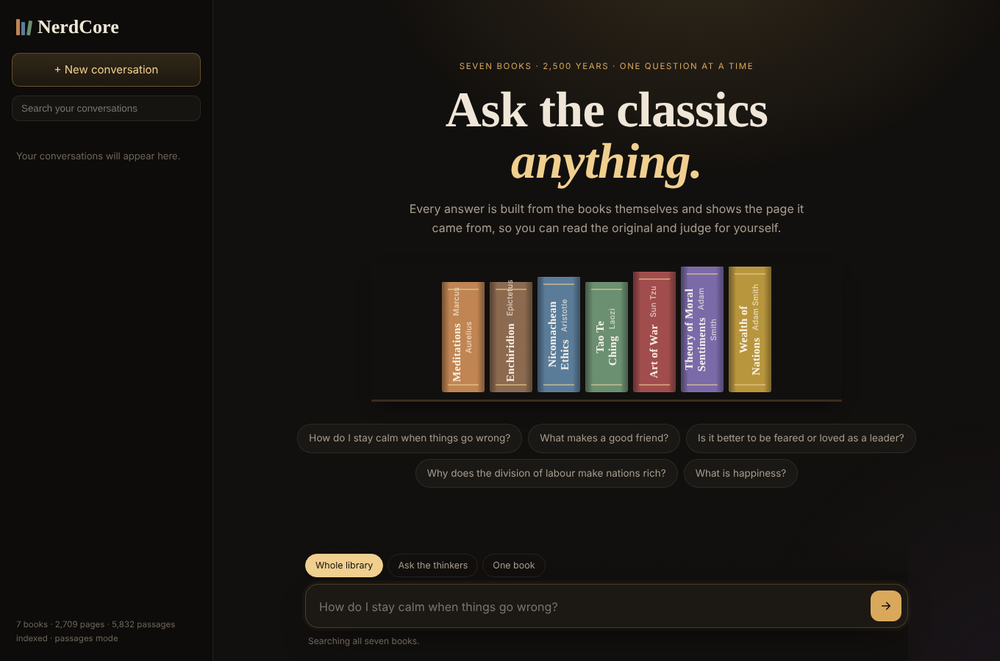
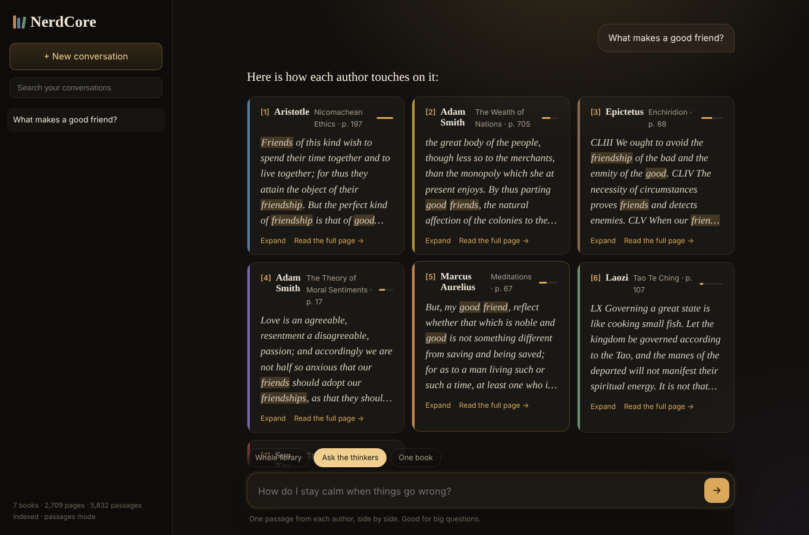

# NerdCore

**Ask seven classic books anything. Every answer shows the page it came from.**

Marcus Aurelius, Epictetus, Aristotle, Laozi, Sun Tzu and Adam Smith (twice): 2,709 pages, 2,500 years of thinking, searchable in plain English. Ask the whole library, one book, or put the same question to every author at once and read their answers side by side.



## What makes it different from "chat with a PDF"

- **The books answer, not the model.** Every response is built from retrieved passages, with author, book and page number. Open any page in the built-in reader to check the context yourself.
- **Ask the thinkers.** One question, one passage from each author, side by side. Good for seeing where Stoics, Taoists and Adam Smith agree or disagree.
- **Modern words, old books.** People ask "how do I stay calm?" but a 19th-century translation says "tranquillity" and "perturbation". A small thesaurus bridges that gap, and with an LLM key the question is also rewritten into period vocabulary before searching.
- **Only the author's own words are searched.** Introductions, editors' notes and endnotes are excluded, so you don't get a translator's footnote as Sun Tzu's opinion.
- **Says no.** If nothing in the books addresses the question, it says so instead of improvising.
- **Your history, private.** Conversations are saved, searchable, renamable and scoped to your browser.



## How it works

```mermaid
flowchart LR
    A[7 public-domain PDFs] -->|scripts/build_corpus.py, once| B[corpus.jsonl.gz<br/>2,709 pages, 1.7 MB]
    B -->|startup, ~0.8 s| C[Main-text filter<br/>drop intros, endnotes, footnote blocks]
    C --> D[Paragraph chunks<br/>never cross a page]
    D --> E[(In-memory BM25 index<br/>5,800 passages)]
    Q[Question] --> T[Thesaurus + optional<br/>LLM keyword rewrite] --> E
    E --> R[Re-rank: term coverage<br/>+ exact phrase bonus]
    R -->|library / book / one-per-author| S[Passages with pages]
    S -->|GROQ_API_KEY set| L[LLM explains, must cite [n];<br/>invented citations stripped]
    S -->|no key| P[Passages shown directly]
```

- **No vector database, no GPU, no model download.** The whole index is built in under a second at startup from a 1.7 MB compressed corpus, so it runs on a free hosting tier.
- **Citations are enforced, not requested.** After generation, any `[n]` that doesn't match a retrieved passage is removed, and only cited passages are shown.
- **Follow-ups work.** The last few turns go to the model, so "and what does Aristotle say?" makes sense.

## Run it

```bash
git clone https://github.com/Deepansh-Deep/nerdcore-ai-library && cd nerdcore-ai-library
python -m venv .venv && source .venv/bin/activate     # Windows: .venv\Scripts\activate
pip install -r backend/requirements.txt
cp .env.example .env                                  # optional: add a free GROQ_API_KEY
cd backend && uvicorn nerdcore.api:app --reload
```

Open http://localhost:8000. Without a key you get the passages themselves; with a key you also get a written explanation that cites them.

Docker: `docker build -t nerdcore . && docker run -p 8000:8000 --env-file .env nerdcore`

**Adding a book:** drop the PDF into `books/`, add its metadata (and the page range of the main text) to `BOOKS` in `backend/nerdcore/library.py`, then run `python scripts/build_corpus.py`.

## Tests

```bash
cd backend && pip install -r requirements-dev.txt && pytest -q
```

14 tests run on the real corpus: known passages are found in the right book (the Tao that can be named, the pin factory, "know the enemy"), editorial matter never appears in results, thinkers mode returns one passage per author, nonsense questions are refused, conversations are private to their owner, and the history API works end to end.

## API

| Method | Path | |
|---|---|---|
| GET | `/api/health` | Books, pages, passages indexed, load time, LLM on/off |
| GET | `/api/books` | The shelf |
| GET | `/api/books/{slug}/pages/{n}` | Read any page, with prev/next |
| POST | `/api/ask` | `{question, mode: library\|book\|thinkers, book?, conversation_id?}` + `X-Reader-Id` header |
| GET / PATCH / DELETE | `/api/conversations[/{id}]` | List (with `?q=` search), read, rename, delete |

## What changed from v1

| v1 | v2 |
|---|---|
| Two versions side by side; the CLI one loaded `books/book.pdf`, which didn't exist | One app |
| `/health` always returned `"database": "connected"` without checking | Reports real index size and load time |
| Editors' introductions and footnotes searched as if the author wrote them | Main-text page ranges + footnote filter |
| 2,000-line stylesheet, 3D face, custom cursor and mouse trail | A reading-room design: book spines, quote cards, page reader |
| Sources listed as raw metadata | Author, book, page, highlighted terms, full-page reader |
| ChromaDB + sentence-transformers (~2 GB installed) | Pure-Python BM25 + thesaurus, ~1 s startup |
| Empty README and ARCHITECTURE.md, stray files named `(`, `[`, `{` | Documentation, 14 tests, CI, Docker |

## Limitations and next steps

- Retrieval is lexical with a hand-written thesaurus. Semantic embeddings (fused with BM25) would catch more paraphrases; the search interface is built so a dense retriever can be added alongside.
- Texts are public-domain English translations from Standard Ebooks; older translations use archaic phrasing.
- Wealth of Nations dominates by size (1,000+ pages). Thinkers mode caps each book at one passage to keep the comparison fair.

## Stack

FastAPI · BM25 (pure Python) · Groq Llama 3.3 70B (optional) · SQLite · pdfplumber (offline corpus build) · vanilla JS, no build step · pytest · GitHub Actions · Docker

---
Built by [Deepansh Deep](https://github.com/Deepansh-Deep). Started during the Generative AI training programme at Haldia Institute of Technology (EEGRAB, Jan 2026), and later rebuilt.
